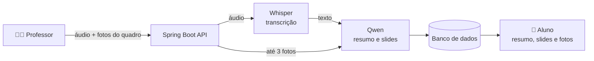
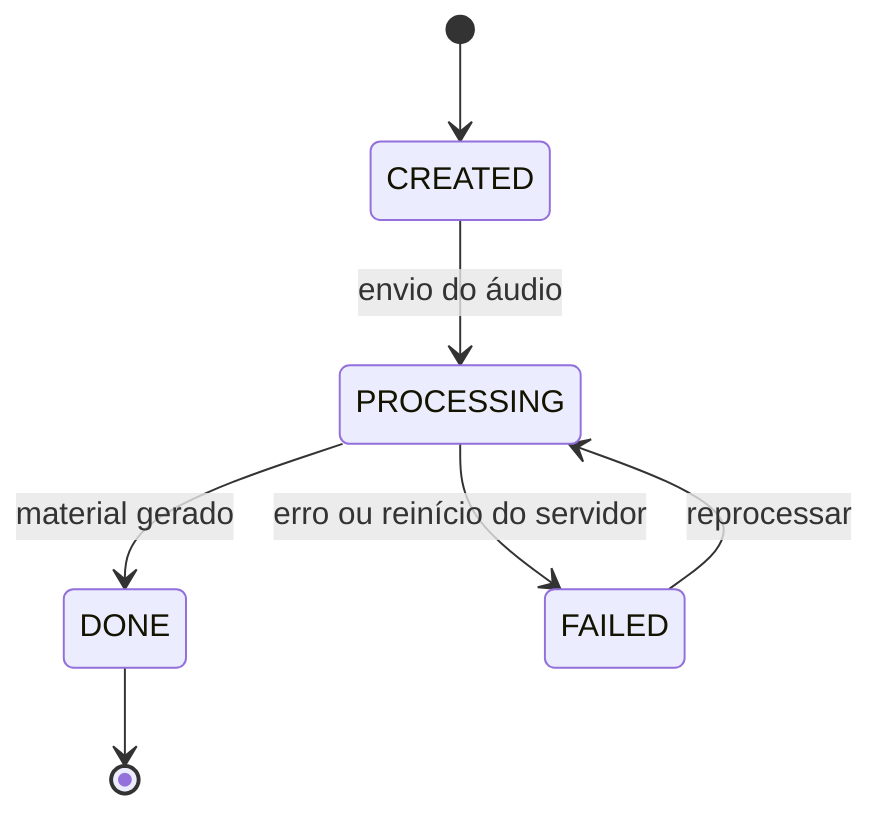

<div align="center">

# AulaViva

**Perdeu a aula? O AulaViva transforma o áudio e as fotos do quadro em um material de estudo organizado.**

Resumo didático e apresentação em slides, gerados com inteligência artificial.

<br>


[Como funciona](#-como-funciona) ·
[Começar](#-começar-rápido) ·
[API](#-principais-endpoints-da-api) ·
[Limitações](#-limitações-conhecidas)

</div>

<br>

<!--
CAPTURAS DE TELA
Salve imagens em docs/img/ e remova as marcas de comentário abaixo.

<div align="center">
  
  
</div>
-->

## 📚 Sobre o projeto

O áudio da aula é enviado ao servidor, processado por inteligência artificial e transformado em um
**resumo didático** e em uma **apresentação em slides**. Fotos do quadro ou dos slides complementam o
áudio na geração do material.

**Objetivo:** permitir que quem faltou a uma aula consulte, depois, um material de estudo organizado,
gerado automaticamente a partir da gravação e das fotos do quadro.

Este repositório é um **monorepositório** com duas partes:

| Parte | O que é |
|---|---|
| 🛠️ **`backend/`** | API REST em Spring Boot, que recebe áudio e fotos e gera o material com IA. |
| 🎨 **`front-end/`** | Aplicação web em React: página de apresentação, biblioteca de aulas do aluno e painel do professor. |

## 🧭 Sumário

- [Como funciona](#-como-funciona)
- [Tecnologias](#-tecnologias)
- [Estrutura do projeto](#-estrutura-do-projeto)
- [Começar rápido](#-começar-rápido)
- [Configuração das variáveis de ambiente](#-configuração-das-variáveis-de-ambiente)
- [Executando o backend](#-executando-o-backend)
- [Executando o front-end](#-executando-o-front-end)
- [Servindo o front-end pelo Spring Boot](#-servindo-o-front-end-pelo-spring-boot)
- [Testes](#-testes)
- [Principais endpoints da API](#-principais-endpoints-da-api)
- [Limitações conhecidas](#-limitações-conhecidas)
- [Próximas etapas](#-próximas-etapas)

## ✨ Como funciona



1. A aula é criada com o estado `CREATED`.
2. Ao receber o áudio, o servidor grava o arquivo, muda a aula para `PROCESSING` e responde na hora
   (`202 Accepted`), sem esperar a IA.
3. Em segundo plano, o Whisper transcreve o áudio (a transcrição é usada internamente na geração do resumo).
4. O Qwen recebe a transcrição e até 3 fotos do quadro/slides, e devolve o resumo e a apresentação em slides.
5. A aula passa para `DONE` com o material gerado, ou para `FAILED`, com o motivo em `failureReason`.
   Nesse caso, `POST /api/lessons/{id}/reprocess` tenta de novo.
6. Se o servidor for reiniciado durante um processamento, as aulas que estavam em `PROCESSING` são
   marcadas como `FAILED` na inicialização e podem ser reprocessadas.



No front-end, o aluno só vê aulas `DONE`; o professor acompanha todos os estados no painel. O motivo
técnico de uma falha (`failureReason`) nunca é mostrado ao aluno.

Mais detalhes em [`docs/architecture.md`](docs/architecture.md). A documentação do front-end está em
[`front-end/docs/front/`](front-end/docs/front/) (`PLANO.md` e `PROGRESSO.md`).

## 🧰 Tecnologias

**Backend**

- Java 21
- Spring Boot 3.5 (Web, Validation, Data JPA)
- PostgreSQL (banco padrão) e H2 (perfil `dev` e testes)
- Maven, com Maven Wrapper
- Docker Compose (PostgreSQL local)
- API da Groq: Whisper (`whisper-large-v3`) para transcrição e Qwen para a geração do resumo

**Front-end**

- React 18 e TypeScript
- Vite 7 (desenvolvimento e build)
- Tailwind CSS 3, com tokens de cor e peças compartilhadas em CSS próprio
- lucide-react (ícones)
- Fontes locais, sem CDN: Cormorant Garamond (títulos) e Manrope (texto)
- Rotas por hash (`#/aulas`), sem biblioteca de roteamento

## 🗂️ Estrutura do projeto

<details>
<summary>Ver a árvore de pastas</summary>

```text
aulaviva/
├── backend/                 API Spring Boot (Maven)
│   ├── .mvn/wrapper/        configuração do Maven Wrapper
│   ├── src/main/java/com/aulaviva/api/
│   │   ├── ai/              integração com a IA (interfaces + clientes da Groq)
│   │   ├── config/          propriedades tipadas, executor assíncrono, cliente HTTP
│   │   ├── controller/      endpoints REST
│   │   ├── dto/             contratos de entrada e saída
│   │   ├── exception/       exceções de domínio e tratamento global de erros
│   │   ├── mapper/          conversão entidade -> DTO
│   │   ├── model/           entidades JPA e enums
│   │   ├── repository/      acesso ao banco (Spring Data JPA)
│   │   └── service/         regras de negócio e processamento em segundo plano
│   ├── src/main/resources/  application.properties, application-dev.properties
│   │   └── static/          build do front-end copiado para cá
│   ├── src/test/            testes e application-test.properties
│   ├── pom.xml
│   ├── mvnw
│   └── mvnw.cmd
├── front-end/               aplicação web (React + Vite)
│   ├── src/
│   │   ├── api/             cliente da API, tipos e dados de exemplo (mock)
│   │   ├── app/             roteador por hash, layout da aplicação e ambiente
│   │   ├── components/      página de apresentação e emblemas em SVG
│   │   ├── features/
│   │   │   ├── aulas/       biblioteca de aulas, detalhe da aula, resumo e fotos
│   │   │   ├── slides/      visualizador de slides, miniaturas e impressão
│   │   │   └── professor/   painel do professor (criar aula, enviar áudio e fotos)
│   │   ├── lib/             resumo, área de transferência, tom por disciplina
│   │   ├── pages/           entrada (#/entrar) e página 404
│   │   ├── styles/          tokens.css e compartilhado.css
│   │   └── textos/          textos em português do Brasil
│   ├── docs/front/          PLANO.md e PROGRESSO.md do front-end
│   ├── package.json
│   └── vite.config.ts
├── docs/
│   └── architecture.md      documentação de arquitetura
├── .env.example             exemplo de variáveis de ambiente
├── .gitignore
├── docker-compose.yml       PostgreSQL local
└── README.md
```

</details>

## 🚀 Começar rápido

**Requisitos**

| Item | Para quê | Observação |
|---|---|---|
| **JDK 21** | Backend | `java -version` deve indicar a versão 21. |
| **Node.js** (LTS) e npm | Front-end | Confira com `node -v` e `npm -v`. |
| **Chave da API da Groq** | Processar as aulas | Criar e listar aulas funciona sem ela. |
| **Docker** com Compose | PostgreSQL local | Opcional: o perfil `dev` usa H2. |

Não é necessário instalar o Maven: o projeto usa o Maven Wrapper (`mvnw`). Na primeira execução é preciso
acesso à internet para baixar o Maven, as dependências Java e os pacotes do front-end.

**O caminho mais curto, com H2 e sem Docker:**

```bash
# 1. backend (terminal 1)
cd backend
./mvnw spring-boot:run -Dspring-boot.run.profiles=dev

# 2. front-end (terminal 2)
cd front-end
npm install
npm run dev
```

Abra `http://localhost:5173`. Para ver a interface sem backend, use `http://localhost:5173/#/aulas?mock=1`.

## 🔐 Configuração das variáveis de ambiente

O backend lê estas variáveis (os valores padrão estão em `backend/src/main/resources/application.properties`):

| Variável | Para que serve | Padrão |
|---|---|---|
| `DB_URL` | URL JDBC do banco | `jdbc:postgresql://localhost:5432/aulaviva` |
| `DB_USER` | Usuário do banco | `postgres` |
| `DB_PASSWORD` | Senha do banco | `postgres` |
| `AI_API_KEY` | Chave da API da Groq | vazio (o processamento falha sem ela) |

O front-end não precisa de variáveis de ambiente.

1. Crie seu arquivo local a partir do exemplo (ele é ignorado pelo Git):

   ```bash
   cp .env.example .env
   ```

2. Edite o `.env` e preencha `DB_PASSWORD` e `AI_API_KEY` com valores seus.

> [!WARNING]
> O Spring Boot não lê o arquivo `.env` sozinho. O Docker Compose lê o `.env` da raiz automaticamente,
> mas, para o backend, as variáveis precisam estar no ambiente do processo.
> Nunca versione o `.env` nem coloque chaves reais no código ou em arquivos de exemplo.

<details>
<summary>Como carregar as variáveis no terminal</summary>

**Linux / macOS** (carrega o `.env` na sessão atual):

```bash
set -a
source .env
set +a
```

**Windows (PowerShell)**:

```powershell
$env:DB_PASSWORD = "sua_senha"
$env:AI_API_KEY  = "sua_chave"
```

Em IDEs (IntelliJ, VS Code), você também pode definir essas variáveis na configuração de execução.

**Alternativa:** criar o arquivo `backend/config/application.properties` (ignorado pelo Git), que o
Spring Boot carrega automaticamente quando a aplicação é executada a partir de `backend/`:

```properties
spring.datasource.password=sua_senha
aulaviva.ai.api-key=sua_chave
```

</details>

### Iniciando o PostgreSQL com Docker

Na raiz do projeto:

```bash
docker compose up -d
```

Isso sobe o PostgreSQL 16 na porta `5432`, com o banco `aulaviva`. O usuário e a senha vêm de `DB_USER`
e `DB_PASSWORD` do `.env` (se não existir, usa `postgres`/`postgres`, os mesmos padrões do backend).

Para parar: `docker compose down`. Para apagar também os dados: `docker compose down -v`.

> [!NOTE]
> Se você alterar `DB_PASSWORD` depois que o volume já foi criado, o PostgreSQL continuará com a senha
> antiga. Use `docker compose down -v` para recriar o banco (isso apaga os dados locais).

## 🛠️ Executando o backend

Com as variáveis configuradas (e o PostgreSQL no ar):

```bash
cd backend
./mvnw spring-boot:run
```

No Windows:

```powershell
cd backend
.\mvnw.cmd spring-boot:run
```

A API sobe em `http://localhost:8080`. Para conferir: `curl http://localhost:8080/status`.

**Sem instalar o PostgreSQL**, use o perfil `dev`, que usa um H2 em arquivo (`backend/data/`):

```bash
cd backend
./mvnw spring-boot:run -Dspring-boot.run.profiles=dev
```

Os áudios e as imagens enviados ficam em `backend/uploads/` (ignorado pelo Git).

## 🎨 Executando o front-end

### Em desenvolvimento

Com o backend rodando na porta `8080`, abra outro terminal:

```bash
cd front-end
npm install
npm run dev
```

> [!TIP]
> No Windows (PowerShell), se o `npm` for bloqueado pela política de scripts, use `npm.cmd` no lugar de `npm`.

O front-end sobe em `http://localhost:5173`. O Vite encaminha as chamadas `/api` e `/status` para
`http://localhost:8080` (configurado em `front-end/vite.config.ts`), então não há problema de CORS.

**Endereços da aplicação** (as rotas usam hash):

| Endereço | O que mostra |
|---|---|
| `http://localhost:5173/#/` | Página de apresentação |
| `http://localhost:5173/#/entrar` | Escolha entre aluno e professor |
| `http://localhost:5173/#/aulas` | Biblioteca de aulas (só aulas com status `DONE`) |
| `http://localhost:5173/#/aulas/{id}` | Aula: resumo, slides, fotos do quadro e vídeo |
| `http://localhost:5173/#/professor` | Painel do professor |

Para ver a interface com dados de exemplo, sem backend, acrescente `?mock=1`, por exemplo
`http://localhost:5173/#/aulas?mock=1`. Sem esse parâmetro, o front-end usa sempre a API real e mostra o
erro verdadeiro quando ela falha.

### Verificações

```bash
cd front-end
npm run typecheck
npm run lint
npm run build
```

## 📦 Servindo o front-end pelo Spring Boot

Em produção, o front-end é gerado como arquivos estáticos e entregue pelo próprio Spring Boot, na mesma
porta da API. Como as chamadas usam caminhos relativos (`/api/...`) e as rotas são por hash, não é
necessário configurar CORS nem redirecionamentos no servidor.

**1. Gere o build**

```bash
cd front-end
npm install
npm run build
```

Isso cria a pasta `front-end/dist`, com `index.html`, `favicon.svg` e `assets/`.

**2. Copie o conteúdo de `dist` para a pasta de recursos estáticos do backend**

Linux / macOS:

```bash
mkdir -p backend/src/main/resources/static
cp -r front-end/dist/* backend/src/main/resources/static/
```

Windows (PowerShell), a partir da raiz do projeto:

```powershell
New-Item -ItemType Directory -Force backend\src\main\resources\static
Copy-Item front-end\dist\* backend\src\main\resources\static -Recurse -Force
```

Se já houver um build antigo em `static/`, apague-o antes para não sobrar arquivo desatualizado.

**3. Suba o backend e abra `http://localhost:8080/`**

A cada mudança no front-end, repita os passos 1 e 2 e reinicie o backend.

> [!IMPORTANT]
> Se o projeto passar a usar Spring Security, libere o acesso público a `/`, `/index.html`, `/assets/**` e
> `/favicon.svg`. Não crie um controller mapeado em `/`, porque ele esconderia o `index.html`.

## 🧪 Testes

```bash
cd backend
./mvnw test
```

No Windows:

```powershell
cd backend
.\mvnw.cmd test
```

Os testes usam o perfil `test` (H2 em memória, pasta de upload em `target/` e sem chave de IA), portanto
não exigem PostgreSQL, Docker nem chave da Groq.

O front-end tem as verificações descritas em [Executando o front-end](#-executando-o-front-end)
(`typecheck`, `lint` e `build`). Ainda não há testes automatizados de interface.

## 🔌 Principais endpoints da API

| Método | Endereço | O que faz | Resposta |
|---|---|---|---|
| `GET` | `/status` | Verifica se o servidor está no ar | `200` |
| `POST` | `/api/lessons` | Cria uma aula (`{"title": "...", "subject": "..."}`) | `201` |
| `GET` | `/api/lessons` | Lista as aulas (mais recentes primeiro) | `200` |
| `GET` | `/api/lessons/{id}` | Detalha a aula, com resumo e slides | `200` |
| `POST` | `/api/lessons/{id}/audio` | Envia o áudio (`multipart`, campo `file`) e inicia o processamento | `202` |
| `POST` | `/api/lessons/{id}/images` | Envia uma foto do quadro/slides (`multipart`, campo `file`) | `201` |
| `GET` | `/api/lessons/{id}/images/{imageId}` | Baixa a foto | `200` |
| `POST` | `/api/lessons/{id}/reprocess` | Processa de novo uma aula que já tem áudio | `202` |

**Formatos aceitos:** áudio `.mp3`, `.wav`, `.m4a`, `.ogg`, `.webm`; imagem `.jpg`, `.jpeg`, `.png`, `.webp`.
**Tamanho máximo de arquivo:** 25 MB.

<details>
<summary>Exemplo de uso com curl</summary>

```bash
# 1. criar a aula
curl -X POST -H "Content-Type: application/json" \
     -d '{"title":"Funções","subject":"Matemática"}' \
     http://localhost:8080/api/lessons

# 2. enviar as fotos do quadro (antes do áudio, pois só entram no resumo as fotos existentes no processamento)
curl -F "file=@quadro.png" http://localhost:8080/api/lessons/1/images

# 3. enviar o áudio (inicia o processamento em segundo plano)
curl -F "file=@aula.mp3" http://localhost:8080/api/lessons/1/audio

# 4. consultar o andamento e o resultado
curl http://localhost:8080/api/lessons/1
```

</details>

Os erros seguem sempre o formato `{ "status", "error", "message", "timestamp" }`.

## ⚠️ Limitações conhecidas

- A API de transcrição aceita arquivos de até **25 MB**. Uma aula inteira em WAV pode passar disso;
  use MP3/M4A comprimido ou divida o áudio.
- Só a extensão do arquivo é validada, não o conteúdo.
- O esquema do banco é gerado pelo Hibernate (`ddl-auto=update`). Para produção, o recomendado é adotar migrações (por exemplo, Flyway).
- No front-end, a aba **Slides** só exibe conteúdo real quando a API devolver a apresentação (`presentation`)
  no detalhe da aula. Enquanto isso, ela avisa que os slides ainda não foram gerados; o exemplo aparece
  apenas com `?mock=1`.
- No front-end, a aba **Vídeo (NotebookLM)** e o diálogo "Como foi gerado" ainda são provisórios.
- O front-end foi desenhado para telas a partir de 360 px, mas a validação visual em navegadores e a
  impressão dos slides em PDF ainda dependem de conferência manual.

> [!CAUTION]
> **Não há autenticação.** Não exponha o servidor na internet. A escolha entre "aluno" e "professor" no
> front-end é só navegação e não protege nenhuma rota.

> [!IMPORTANT]
> Aulas que gravam menores de idade exigem autorização da escola e aviso de gravação.

## 🗺️ Próximas etapas

- [ ] Retornar a apresentação em slides no detalhe da aula e indicar, na listagem, quais aulas têm slides e fotos.
- [ ] Guia do NotebookLM e diálogo de transparência "Como foi gerado" no front-end.
- [ ] Compressão/divisão automática de áudios longos.
- [ ] Login de professores e alunos.
- [ ] Migrações de banco com Flyway.